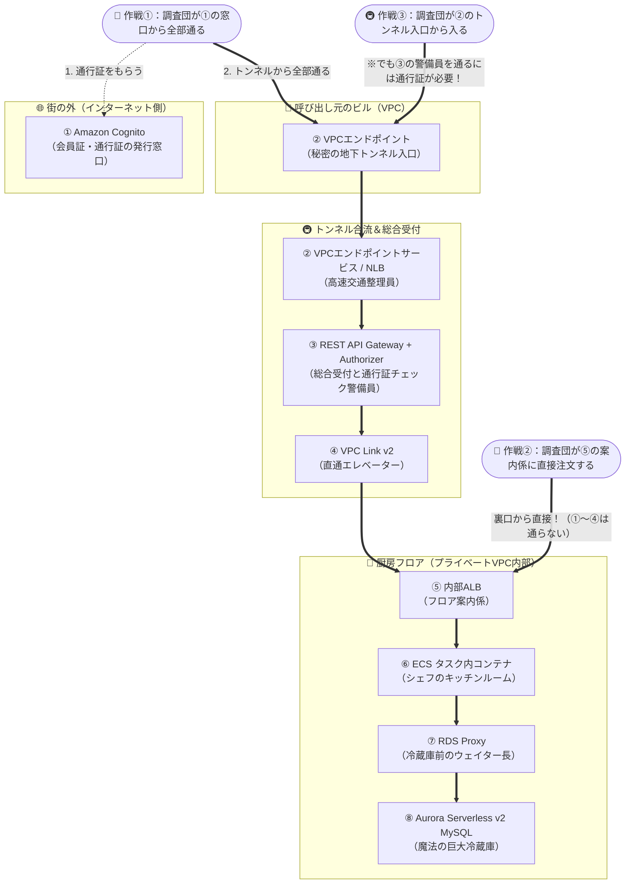
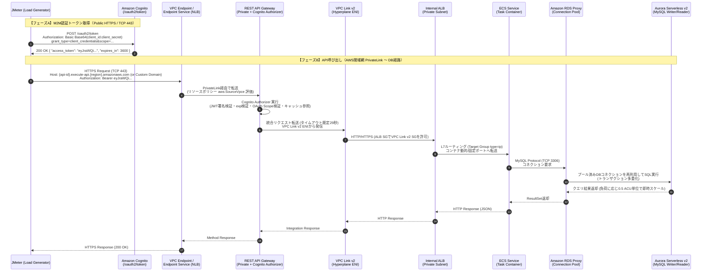

# Private REST API Gateway 閉域網アーキテクチャにおける JMeter 負荷テスト方式の徹底分析・設計完全ガイド

---

## 目次

1. [エグゼクティブサマリー（結論と推奨テスト戦略）](#1-エグゼクティブサマリー結論と推奨テスト戦略)
2. [小学生にもわかる！このシステムの仕組みと3つのテスト作戦](#2-小学生にもわかるこのシステムの仕組みと3つのテスト作戦)
3. [対象アーキテクチャの全体像と通信経路の精密解剖](#3-対象アーキテクチャの全体像と通信経路の精密解剖)
4. [各コンポーネントの登場の歴史・背景・必要になった経緯と最新仕様（2026年最新情報反映）](#4-各コンポーネントの登場の歴史背景必要になった経緯と最新仕様2026年最新情報反映)
5. [JMeter 負荷テスト3方式の重厚分析（テスト容易性・メリット・デメリット・盲点）](#5-jmeter-負荷テスト3方式の重厚分析テスト容易性メリットデメリット盲点)
   - [方式①：Cognito M2Mアクセストークン取得＋フル経路（E2E）方式](#51-方式①cognito-m2mアクセストークン取得フル経路e2e方式)
   - [方式②：内部ALB（Internal ALB）直接接続方式](#52-方式②内部albinternal-alb直接接続方式)
   - [方式③：VPCエンドポイントサービス（NLB）／VPCエンドポイント接続方式](#53-方式③vpcエンドポイントサービスnlbvpcエンドポイント接続方式)
   - [3方式の厳密評価マトリクス](#54-3方式の厳密評価マトリクス)
6. [各方式を採用する場合に「JMeter用として設定を変更すべき箇所」の完全マニュアル](#6-各方式を採用する場合にjmeter用として設定を変更すべき箇所の完全マニュアル)
   - [6.1 実行端末（JMeter Load Generator）の配置とネットワーク設定](#61-実行端末jmeter-load-generatorの配置とネットワーク設定)
   - [6.2 Amazon Cognito のJMeter専用設定追加手順](#62-amazon-cognito-のjmeter専用設定追加手順)
   - [6.3 Amazon API Gateway (REST API) のJMeter専用Authorizer・ポリシー変更手順](#63-amazon-api-gateway-rest-api-のjmeter専用authorizerポリシー変更手順)
   - [6.4 VPCエンドポイントサービス（NLB）・VPCエンドポイントの設定変更手順](#64-vpcエンドポイントサービスnlbvpcエンドポイントの設定変更手順)
   - [6.5 内部ALB（Internal ALB）のJMeter用許可設定・ヘッダ模倣手順](#65-内部albinternal-albのjmeter用許可設定ヘッダ模倣手順)
   - [6.6 バックエンド（ECS / RDS Proxy / Aurora Serverless v2）の事前確認・調整項目](#66-バックエンドecs--rds-proxy--aurora-serverless-v2の事前確認調整項目)
7. [JMeter シナリオ（.jmx）の実装設計とGroovyスクリプト完全版](#7-jmeter-シナリオjmxの実装設計とgroovyスクリプト完全版)
8. [負荷テスト時の典型的なハマりどころ（7大トラップ）と対策一覧](#8-負荷テスト時の典型的なハマりどころ7大トラップと対策一覧)

---

## 1. エグゼクティブサマリー（結論と推奨テスト戦略）

対象システムの通信経路は以下の8段階から構成される高度なAWS閉域網（プライベート）アーキテクチャです。

```text
[1. Amazon Cognito (M2Mアクセストークン取得)]
   ↓ (取得したJWTをAuthorizationヘッダに付与)
[2. VPCエンドポイントサービス(NLB) / インターフェースVPCエンドポイント]
   ↓ (AWS PrivateLink 閉域通信)
[3. Amazon API Gateway (Private REST API + Cognito Authorizer)]
   ↓ (VPC Link v2 ※2025年11月REST API対応)
[4. 内部ALB (Internal Application Load Balancer)]
   ↓ (L7ターゲットグループ / IPターゲット)
[5. Amazon ECS サービス (タスク内コンテナ)]
   ↓ (JDBC / MySQLプロトコル)
[6. Amazon RDS Proxy (コネクションプーリング / マルチプレキシング)]
   ↓
[7. Amazon Aurora Serverless v2 (MySQL)]
```

この経路に対してJMeterで負荷テストを実施する際、**「① Cognitoからすべてを通すフル経路方式」「② 内部ALBに直接接続する方式」「③ VPCエンドポイントサービス（NLB）／VPCエンドポイントにつなげる方式」** のどれを選ぶべきかに対するエンジニアリング上の厳密な結論は以下の通りです。

### 結論：単一方式への固執はNG。「フェーズ分割ハイブリッド方式（方式② → 改良版方式①/③）」が唯一無二の最適解

1. **【アンチパターン（絶対に避けるべきやり方）】**
   - **「JMeterの1リクエスト（1イテレーション）ごとにCognitoの `/oauth2/token` を呼び出してアクセストークンを取得し、そのままAPI Gatewayを叩く」シナリオ**は絶対に組んではいけません。
   - **理由**:
     1. Amazon CognitoのM2M認証（`ClientAuthentication` カテゴリ：`grant_type=client_credentials`）には、**デフォルトで 150 RPS（秒間150リクエスト）のハードクォータ**が存在します。150 RPSを超えた瞬間にCognito側で `HTTP 429 Too Many Requests` が大量発生し、本来測りたいAPIやDBに負荷が届く前にテストが破綻します。
     2. CognitoのM2Mトークン発行にはリクエスト数に応じた従量課金およびApp Client単位の課金が発生するため、高負荷テストで数百万回トークンを発行すると**不要なAWSコストが爆発**します。
     3. 本番のM2Mクライアントも通常はトークンを有効期限（例：1時間）の約75%の間キャッシュして使い回す設計がベストプラクティスであり、毎リクエストごとにトークンを再取得する挙動は本番のトラフィック特性と乖離しています。

2. **【ステップ1：アプリケーション・DB限界性能テスト（負荷試験前半）＝ 方式②（内部ALB直接接続）を推奨】**
   - ECSコンテナ内のアプリケーションロジック、コンテナのCPU/メモリ設定、RDS Proxyのコネクションプール効率、Aurora Serverless v2のACUスケーリング挙動、SQLクエリのボトルネックを純粋かつ高スループットで測定・チューニングするフェーズでは、**方式②（VPC内のJMeter端末から内部ALBへ直接接続）** が最もテスト容易性が高く、ノイズがありません。
   - インターネット接続（NAT Gateway等）も不要であり、CognitoやAPI Gatewayのスロットリング制限に邪魔されずにバックエンドの限界性能（ピークTPS・レイテンシ）を正確に測定できます。

3. **【ステップ2：エンドツーエンド統合・インフラ経路検証テスト（負荷試験後半・総合確認）＝ 改良版・方式①（＝方式③のトークンキャッシュ統合型）を推奨】**
   - 内部ALB直接接続（方式②）だけでは、**「VPCエンドポイント／NLBの帯域・ENI分散」「API Gatewayのリソースポリシー・スロットリング制限・統合タイムアウト（デフォルト29秒）」「Cognito AuthorizerのJWT検証処理とキャッシュ挙動」「VPC Link v2の通信オーバーヘッド」** が一切テストできません。
   - そこで最終検証では、**「JMeterの `setUp Thread Group`（テスト開始時の1回のみ）または数十分おきの背景スレッドでCognitoからM2Mアクセストークンを取得してJMeterメモリ上にキャッシュし、メインの負荷スレッド群はキャッシュされたトークンを使ってVPCエンドポイント（またはVPCエンドポイントサービスNLB）経由でAPI Gateway → VPC Link v2 → ALB → ECS → RDS Proxy → Aurora までを一気通貫で呼び出す」** シナリオを実行します。
   - これにより、Cognitoの150 RPS制限やパブリック通信のオーバーヘッドを完全に回避しつつ、本番と100%同一の閉域網経路を通したE2E負荷テストが実現します。

4. **【方式③（VPCエンドポイント／NLB接続）に関する極めて重要な技術的注意点】**
   - 「VPCエンドポイント（またはNLB）に直接つなげば、Cognitoの設定やトークン取得は不要になるのでは？」と誤解されがちですが、**VPCエンドポイントのすぐ後ろにいるAPI Gateway（REST API）にはCognito Authorizerが構えています**。
   - したがって、VPCエンドポイントから入ったとしても、リクエストに有効なJWT（Cognitoアクセストークン）が付いていなければ、API Gatewayで **`401 Unauthorized` で即座に拒否** されます。
   - つまり方式③を採る場合でも、**「(A) 事前に1回だけCognitoからトークンを取得してヘッダにセットする」** か、**「(B) JMeter専用のCognito App Client / Authorizer設定を追加する」** か、**「(C) API GatewayにJMeter専用の認証なしステージ／メソッドを用意する」** のいずれかが必ず必要になります。

---

## 2. 小学生にもわかる！このシステムの仕組みと3つのテスト作戦

まずは専門用語をいったん横に置いて、このシステムが何をしているのか、なぜこんなたくさんの仕組みが並んでいるのかを**「ひみつの会員制レストラン街」**にたとえて見てみましょう！

### 2.1 登場人物（8つの仕組み）の役割

あなたが作ったシステムは、セキュリティがとっても厳しい**「地下にあるVIP専用の会員制レストラン街」**です。お客さん（別のシステム）が料理（データ）を注文してから届くまでに、8人のスタッフと設備がリレー形式で働いています。

| 順番 | AWSの仕組みの名前 | レストラン街でのたとえ | 小学生向けのわかりやすい説明（なぜ必要なの？） |
| :---: | :--- | :--- | :--- |
| **①** | **Amazon Cognito**<br>（コグニート） | **街の表通りにある<br>「会員証（通行手形）の発行窓口」** | レストラン街に入る前に、まず身分証を見せて**「今から1時間だけ使える魔法の通行証（アクセストークン）」**を発行してもらう窓口です。この窓口だけは、誰でも手続きできるように**外の大きな通り（インターネット）**に面しています。 |
| **②** | **VPCエンドポイントサービス(NLB)<br>＆ VPCエンドポイント** | **別のビルから直結する<br>「会員専用の秘密の地下トンネルと改札口」** | 通行証をもらったお客さんが、危ない外の道路（インターネット）を歩かずに、自分のビルからレストラン街の入口まで**地下の専用トンネル**で安全に移動するための通路です。トンネルの合流地点では**NLB（超高速の交通整理員）**が混雑を防いでいます。 |
| **③** | **REST API API Gateway**<br>＆ **Cognito Authorizer** | **レストラン街の<br>「総合受付と厳しい警備員」** | 地下トンネルを抜けたところにある総合受付です。ここにいる警備員（Authorizer）が**「①の窓口でもらった本物の通行証を持っているか？」**を厳しくチェックします。偽物や期限切れならここで追い返します。また、1秒間に入れる人数を制限して店を守る役割もしています。 |
| **④** | **VPC Link v2**<br>（ブイピーシー・リンク・ブイツー） | **受付から厨房フロアへ降りる<br>「スタッフ専用の直通エレベーター」** | 総合受付（API Gateway）を通過した注文を、さらに奥にあるお店のフロア（VPC内部）へ届ける専用エレベーターです。昔（v1）はエレベーターを降りたところに別の荷物係（NLB）が必要でしたが、**最新型（v2）になってからはフロア案内係（ALB）へ直接つながる**ようになりました！ |
| **⑤** | **内部ALB**<br>（アプリケーション・ロードバランサー） | **厨房フロアの<br>「フロア案内係（振り分けリーダー）」** | 注文の内容（「お肉料理」「デザート」など＝URLのパスやヘッダ）を見て、今すぐ対応できる元気なシェフの部屋へ順番にバランスよく注文を振り分ける案内係です。 |
| **⑥** | **ECSサービス**<br>（タスク内コンテナ） | **料理を作る<br>「シェフたちのキッチンルーム」** | 実際にプログラムが動いて注文を処理する部屋（コンテナ）です。お客さんが増えて忙しくなると、同じ設計図からキッチンルームの数（タスク）を自動で増やして対応します。 |
| **⑦** | **RDS Proxy**<br>（アールディーエス・プロキシ） | **冷蔵庫の前で注文を整理する<br>「ベテランのウェイター長」** | もし100人のシェフが全員バラバラに巨大冷蔵庫（データベース）のドアを開け閉めしたら、ドアが壊れてしまいますよね。そこでウェイター長（RDS Proxy）が間に入り、**数本の専用扉（コネクション）だけをうまく使い回して**、シェフたちの材料の出し入れを整理します。 |
| **⑧** | **Aurora Serverless v2 MySQL**<br>（オーロラ・サーバーレス・ブイツー） | **自動で広さが変わる<br>「魔法の巨大冷蔵庫（食料庫）」** | 大事なデータが全部入っているデータベースです。普通の冷蔵庫は急に大きくできませんが、この魔法の冷蔵庫は**注文が増えると1秒以下でグングン大きくなり、夜中に誰も来なくなると自動で眠って電気代をゼロにできる**すごい冷蔵庫です。 |

---

### 2.2 「JMeter（ジェイメーター）」ってなに？

**JMeter（Apache JMeter）** は、お店がオープンする前に**「もし1,000人のお客さんがいっせいに注文したら、お店はどこかでパンクしないかな？何秒で料理が出せるかな？」**をテストしてくれる**「1,000人のロボット覆面調査団」**です。

今回の悩みは、**「この1,000人のロボット調査団（JMeter）を、お店のどこからスタートさせるのが一番いいの？」**ということです！



### 2.3 3つのテスト作戦を小学生向けに比べると？

#### 🏃 作戦①：最初から最後までぜんぶ通る作戦（Cognito → トンネル → 受付 → 案内係 → シェフ → 冷蔵庫）
* **どんな作戦？**: 本物のお客さんとまったく同じように、外の窓口（Cognito）で通行証をもらってから、地下トンネルを通って最後まで注文する作戦です。
* **いいところ**: 「お店全体のどこに弱いところがあるか」を本物そっくりに全部テストできます！
* **気をつけること（ここが一番大事！）**:
  * 通行証の窓口（Cognito）は外の大通り（インターネット）にあるので、調査団がいる部屋から外の大通りへ出られる道（インターネット接続）が必要です。
  * しかも、**「料理を1皿頼むたびに、毎回窓口に行って新しい通行証をもらい直す」**というやり方をすると、窓口のお姉さんが「1秒間に150人までしか発行できません！（150 RPS制限）」とパニックになってしまいます。
  * だから、**「テストが始まる前に1回だけ通行証をもらって、1時間のテスト中はその通行証をコピーして全員で使う（トークンキャッシュ）」**という工夫をすれば、窓口をパンクさせずに全部のルートをバッチリテストできます！

#### 🚪 作戦②：裏口から入って「フロア案内係（内部ALB）」に直接注文する作戦
* **どんな作戦？**: 外の窓口（Cognito）も、地下トンネル（VPCエンドポイント）も、総合受付（API Gateway）もぜんぶ飛ばして、厨房フロアの中にいる「案内係（内部ALB）」に直接調査団が注文を渡す作戦です。
* **いいところ**:
  * 外の大通り（インターネット）に出る必要がありません！
  * 通行証のチェックなどで邪魔されないので、「シェフ（ECS）とウェイター長（RDS Proxy）と魔法の冷蔵庫（Aurora）が、最大で何人分の料理を作れるか」を一番カンタンに、正確に測れます！
* **気をつけること**:
  * 普段は案内係（内部ALB）は「直通エレベーター（VPC Link v2）から来た注文しか受け付けない」という鍵（セキュリティグループ）がかかっています。そのため、テストのときだけ「調査団からの直接の注文も受け付けていいよ」と鍵を開けてあげる必要があります。
  * また、総合受付（API Gateway）や地下トンネルを通らないので、「受付の警備員が混雑でパンクしないか？」はこの作戦だけでは分かりません。

#### 🚇 作戦③：地下トンネルの入口（VPCエンドポイント／NLB）からスタートする作戦
* **どんな作戦？**: 外の窓口（Cognito）には行かず、地下トンネル（VPCエンドポイント／NLB）からスタートする作戦です。
* **ちょっと待って！大事な落とし穴**:
  * 「トンネルから入れば、通行証（Cognito）はいらないんじゃない？」と思うかもしれませんが、**トンネルを抜けた先には総合受付の警備員（API GatewayのCognito Authorizer）が立っています！**
  * 通行証を持たずにトンネルに入ると、警備員に「通行証がない人は通せません！（401エラー）」と追い返されてしまいます。
  * そのため、この作戦を使うには、**「テストの前に1枚だけ本物の通行証を用意して調査団に持たせる」**か、**「警備員に『調査団の特別バッジなら通してよし』と特別ルールを追加する」**必要があります。それさえできれば、インターネットに出なくてもトンネルから奥を全部テストできる、とっても賢い作戦になります！

---

## 3. 対象アーキテクチャの全体像と通信経路の精密解剖

ここからは、シニアクラウドアーキテクト・パフォーマンスエンジニアの視点で、対象経路のプロトコル・ネットワーク・認証認可のメカニズムを厳密に解剖します。

### 3.1 エンドツーエンド通信経路のレイヤー構造

対象システムの通信経路において、各コンポーネント間でどのようなプロトコル・名前解決・認証・コネクション管理が行われているかを整理します。



### 3.2 「VPCエンドポイントサービス（NLB）→ VPCエンドポイント → REST API Gateway」の2つの構成パターン

ご提示いただいた経路の「VPCエンドポイントサービス（NLB）、VPCエンドポイントを通り、REST API API Gatewayを経由して…」という部分には、AWSアーキテクチャ上、以下の2つの実装パターンが存在します。本ドキュメントおよびExcel設計書では、**いずれのパターンであっても完全に適用できるよう両方に対応した解説**を行っています。

1. **パターンA（AWS PrivateLinkの標準メカニズムとしての構成）**
   - Private REST API Gatewayを利用する場合、呼び出し元VPCにインターフェースVPCエンドポイント（`com.amazonaws.<region>.execute-api`）を作成します。
   - AWS PrivateLinkの内部アーキテクチャとして、呼び出し元のVPCエンドポイント（ENI）は、AWSマネージド側にある**VPCエンドポイントサービス（その実体はAWS側が管理するNetwork Load Balancer群）**へ接続し、そこからAPI Gatewayへトラフィックが渡されます。
2. **パターンB（マルチアカウント／拠点間接続で独自NLBのVPCエンドポイントサービスを前段に置く構成）**
   - 外部連携先VPC（Consumer VPC）とAPI提供側VPC（Provider VPC）が分かれており、Provider VPC内に**独自のNLBを用いたVPCエンドポイントサービス（PrivateLink）**を構築し、Consumer VPC側の**インターフェースVPCエンドポイント**から受けた通信を、NLBのターゲットグループ（ターゲットIPとして `execute-api` VPCエンドポイントのENI IPアドレスを指定）経由でPrivate REST API Gatewayへフォワーディングする構成です。
   - このパターンBは、金融機関や大規模エンタープライズシステムで「複数システム共通のプライベートゲートウェイ窓口（NLB）を1つに束ねたい」「固定IPや独自ドメイン証明書をNLB側で終端・中継したい」場合によく採用されます。

---

## 4. 各コンポーネントの登場の歴史・背景・必要になった経緯と最新仕様（2026年最新情報反映）

なぜこのような多段構成が必要になったのか？それぞれのAWSサービスおよびJMeterが登場した歴史的背景と、解決してきた技術的課題、そして**2024年〜2026年時点の最新仕様**を体系的に紐解きます。

---

### 4.1 Amazon Cognito（M2Mアクセストークン取得）
* **登場の歴史**:
  * **2014年7月**: モバイルアプリ向けのIDフェデレーション＆データ同期サービス（Cognito Identity / Sync）として発表。
  * **2016年4月（同年7月GA）**: フルマネージドなユーザーディレクトリ機能である **Cognito User Pools** が登場。OAuth 2.0 および OpenID Connect (OIDC) 標準のトークン発行基盤となった。
  * **2017年後半〜**: サーバーレス・マイクロサービス化の進展に伴い、人間のログインだけでなくバッチやバックエンドシステム間の通信認可（**M2M: Machine-to-Machine認証**）の需要が急増。User Poolのドメインとリソースサーバー（Custom Scope）を用いた **OAuth 2.0 `client_credentials` グラントフロー** が標準機能として定着した。
  * **2024年11月〜最新**: Cognitoの料金・機能ティアが **Lite / Essentials / Plus** に刷新され、M2M認証（App Client数およびM2Mトークンリクエスト数）に関するティア管理とクォータ制御が明確化された。
* **必要になった経緯（なぜ使うのか？）**:
  * 以前はシステム間通信の認証に「固定APIキー」や「IPアドレス制限」「自前実装の認証DB」が使われていたが、固定キーの漏洩リスクやローテーションの困難さ、認証DBが負荷のボトルネックになる問題があった。
  * CognitoのM2M認証を使うことで、有効期限付きの署名付きJWT（JSON Web Token）を標準プロトコルで発行でき、受け手（API Gateway）は**DBに問い合わせることなく公開鍵（JWKS）の暗号検証だけで高速・ステートレスに認可**できるようになった。
* **最新仕様と負荷テスト上の最重要ポイント**:
  * `/oauth2/token` エンドポイントに対する `client_credentials` リクエスト（`ClientAuthentication` カテゴリ）のデフォルトレートリミットは **150 RPS（秒間150リクエスト）** です（Service Quotasから上限緩和申請およびプロビジョニング調整が可能）。
  * AWS公式ベストプラクティスとして、M2Mアクセストークンはリクエストごとに取得するのではなく、**有効期限（デフォルト60分、設定可能範囲5分〜24時間）の約75%の期間はクライアント側でキャッシュして再利用すること**が強く推奨されています。

---

### 4.2 AWS PrivateLink（VPCエンドポイントサービス [NLB] ＆ インターフェースVPCエンドポイント）
* **登場の歴史**:
  * **2015年5月**: S3向けの **Gateway VPC Endpoint** が登場（当時はS3とDynamoDBのみ）。
  * **2017年9月**: **Network Load Balancer (NLB)** が登場。AWS独自のソフトウェア定義ネットワーク技術 **AWS Hyperplane** を基盤とし、毎秒数百万リクエスト・超低遅延・固定IP/Elastic IP対応を実現。
  * **2017年11月**: NLBとHyperplaneを中核技術として、任意のTCPサービスやAWSサービスをVPC内部のプライベートIP（ENI）として安全に公開・接続できる **AWS PrivateLink（インターフェースVPCエンドポイント ＆ VPCエンドポイントサービス）** が発表。
* **必要になった経緯（なぜ使うのか？）**:
  * PrivateLink以前は、異なるVPC間やサービス間でプライベート通信を行うには **VPCピアリング（VPC Peering）** やVPNを使うしかなかった。しかしVPCピアリングには「① IPアドレス帯（CIDR）が重複していると接続できない」「② ネットワーク全体が双方向に露出するためセキュリティ境界を引きにくい」「③ 推移的ルーティング（A→B→C）ができない」という3大課題があった。
  * PrivateLink（VPCエンドポイント＋NLBによるエンドポイントサービス）の登場により、**「IPアドレス帯が重複していても関係なく」「クライアントからサービスへの単方向（片方向）のTCP通信だけを」「インターネット（IGW/NAT GW）を一切経由せずに」** 接続できるようになった。

---

### 4.3 Amazon API Gateway（REST API / Private REST API / Cognito Authorizer）
* **登場の歴史**:
  * **2015年7月**: AWS Lambda（2014年11月登場）と組み合わせてサーバーレスAPIを構築するためのフルマネージドAPI管理サービスとして **Amazon API Gateway (REST API)** がGA。
  * **2016年7月**: Cognito User Poolsと直接統合し、API Gateway層でJWTの検証を行う **Cognito Authorizer (`COGNITO_USER_POOLS`)** が登場。
  * **2018年6月**: AWS PrivateLink（`com.amazonaws.<region>.execute-api` VPCエンドポイント）と統合し、VPC内部からのみアクセス可能な **Private REST API** が登場。
  * **2024年6月（重大アップデート）**: 2015年のサービス開始以来、約9年間にわたって「ハードリミット（変更不可）」とされてきた **最大29秒（29,000ミリ秒）の統合タイムアウト制限** が、Regional REST APIおよびPrivate REST APIにおいて **Service Quotasからの申請により29秒超へ引き上げ可能** になった。
* **必要になった経緯（なぜ使うのか？）**:
  * 各マイクロサービス（ECSコンテナ等）で個別に「JWTトークンの検証」「レートリミット（スロットリング）」「リクエスト/レスポンスのバリデーションと変換」「アクセスログ・監査証跡」を実装すると、開発コストが膨大になりセキュリティ品質にばらつきが出る。
  * API Gatewayを最前線のゲートキーパーとして配置することで、不正な通信や過剰なトラフィックをアプリケーション（ECS）やDB（Aurora）に到達する前にエッジ／ゲートウェイ層で遮断できるようになった。

---

### 4.4 API Gateway VPC Link v2（REST API における2025年11月の歴史的進化）
* **登場の歴史と背景**:
  * **2017年11月（VPC Link v1 の登場）**: API Gateway（AWS管理VPC）からユーザーVPC内のプライベートリソースへ接続するために **VPC Link（v1）** が登場。しかしv1はPrivateLinkの仕組みをそのまま使っていたため、**接続先としてNLB（Network Load Balancer）しか指定できなかった**。そのため、バックエンドでALBのパスルーティングやWAFを使いたい現場では、`API Gateway → VPC Link v1 → NLB → 内部ALB → ECS` という**「NLBとALBの二重配置（NLB-ALBサンドイッチ構成）」**を強いられ、コスト増・管理複雑化・ホップ数増加が長年の悩みとなっていた。
  * **2019年12月（HTTP API と VPC Link v2 の登場）**: 軽量版の **HTTP API (API Gateway v2)** と同時に **VPC Link v2** が登場。VPC Link v2はHyperplane ENIをユーザーVPC内に直接展開する方式を採用したため、**NLBなしで内部ALBへ直接接続**できるようになった。しかし当時、VPC Link v2はHTTP API専用であり、Private API公開やリソースポリシー、リクエストバリデーションなど豊富な機能を持つ **REST API（v1）では長らく利用できなかった**。
  * **2025年11月21日（最新アップデート：REST APIでのVPC Link v2サポート！）**: ついにAWSは **Amazon API Gateway REST API においても VPC Link v2 による内部ALB直接統合を正式サポート** した。これにより、Private REST APIの豊富な機能（リソースポリシー、Cognito Authorizer、WAF統合、29秒超タイムアウト等）を維持したまま、中継NLBを廃止して `REST API → VPC Link v2 → 内部ALB` と直結する本システムのモダン構成が実現した！

---

### 4.5 内部ALB（Internal Application Load Balancer）
* **登場の歴史**:
  * **2009年5月**: 初代 Elastic Load Balancing（現在のClassic Load Balancer: CLB）が登場。
  * **2016年8月**: OSI第7層（アプリケーション層：HTTP/HTTPS/HTTP2/WebSocket、のちにgRPC）に特化した **Application Load Balancer (ALB)** が登場。
* **必要になった経緯（なぜ使うのか？）**:
  * コンテナ（ECS）時代になり、1つのホストやVPC内で多数のマイクロサービスが動くようになると、CLBのように「1サービス＝1ロードバランサー」ではコストと管理が破綻した。
  * ALBはURLのパス（`/api/v1/users` と `/api/v1/orders`）やHostヘッダ、HTTPヘッダに基づいて単一のALBから複数のECSターゲットグループへ柔軟にルーティングでき、さらにECSの `awsvpc` モード（各コンテナタスクのプライベートIP）へ直接ヘルスチェックと負荷分散を行えるため、コンテナ基盤の標準L7ルーターとなった。

---

### 4.6 Amazon ECS サービス（タスク内コンテナ）
* **登場の歴史**:
  * **2014年11月発表（2015年4月GA）**: Dockerコンテナの急速な普及を受け、AWSネイティブのコンテナオーケストレーターとして **Amazon EC2 Container Service（現 Amazon Elastic Container Service: ECS）** が登場。
  * **2017年11月**: 各ECSタスクに専用のElastic Network Interface (ENI) を割り当てる **`awsvpc` ネットワークモード** と、EC2管理不要のサーバーレスコンテナ実行環境 **AWS Fargate** が登場。
* **必要になった経緯（なぜ使うのか？）**:
  * 従来のEC2仮想マシン単位のデプロイでは、OSパッチ管理、環境差異、スケールアウトの遅さ（数分〜十数分）が課題だった。
  * ECSにより、アプリケーションとランタイムをコンテナイメージとして不可分にパッケージングし、ALBと連動した迅速なオートスケーリングと、タスク単位の厳密なSecurity Group制御（`awsvpc` モード）が可能になった。

---

### 4.7 Amazon RDS Proxy
* **登場の歴史**:
  * **2019年12月（re:InventにてPreview発表）／2020年6月GA**: AWS LambdaやECSコンテナ向けのフルマネージドDBプロキシとして登場。
* **必要になった経緯（なぜ使うのか？）**:
  * ECSタスクやLambdaが負荷に応じて数十〜数百並列に急拡大（スケールアウト）すると、各コンテナ内のDBコネクションプール（HikariCP等）が一斉にMySQLへ物理コネクションを確立しようとする。すると、MySQLのメモリ消費増大や `max_connections` 上限到達（`Too many connections` エラー）、大量のTCP/TLSハンドシェイクによるCPUスパイクが発生し、DBが連鎖障害を起こす問題が頻発した。
  * **RDS Proxy** をECSとAuroraの間に挟むことで、アプリケーションからの数千の論理接続を受け止めつつ、**トランザクション単位で少数の物理DBコネクションを多重化（マルチプレキシング）して使い回す**ことが可能になった。さらに、Auroraのフェイルオーバー時にもアプリ側の接続を維持したまま新しいWriterへ切り替えることで、**フェイルオーバー時間を最大66%以上短縮**する役割も担う。

---

### 4.8 Amazon Aurora Serverless v2 MySQL
* **登場の歴史**:
  * **2015年7月**: クラウド向けにストレージとコンピュートを分離再設計した **Amazon Aurora (MySQL互換)** がGA。
  * **2018年8月**: **Aurora Serverless v1** が登場。しかしv1は「倍々（1→2→4→8 ACU）でしかスケールしない」「スケール時に数秒間クエリが停止する」「RDS Proxyやリードレプリカ、Multi-AZに非対応」という制約があった。
  * **2022年4月**: アーキテクチャを根本から刷新した **Amazon Aurora Serverless v2** がGA。Linuxカーネルとバッファプールをオンラインで動的拡縮する技術により、**接続を一切切断せずにミリ秒単位で 0.5 ACU（Aurora Capacity Unit：約1 GiB RAM相当）刻みのきめ細かなスケーリング**を実現し、RDS Proxy・Multi-AZ・Global Databaseにも完全対応した。
  * **2024年10月**: 最大キャパシティが従来の128 ACUから **最大 256 ACU（約512 GiB RAM）** へと倍増。
  * **2024年11月（最新重要アップデート）**: 待望の **最小 0 ACU（自動一時停止・再開機能：Auto-pause）** がAurora Serverless v2でもついにサポートされた（アイドル時にコンピュート課金をゼロにし、接続検知時に自動再開）。

---

### 4.9 Apache JMeter
* **登場の歴史**:
  * **1998年後半**: Apache Software Foundationの **Stefano Mazzocchi** 氏によって、Apache JServプロジェクト（のちのTomcatの前身）の性能テストを行うための100%純Javaアプリケーションとして開発が開始された。
  * **2000年代〜2010年代**: 当時非常に高価だった商用負荷テストツール（Mercury LoadRunner等）に対するオープンソースのデファクトスタンダードとして進化。HTTP/HTTPSだけでなくJDBC、JMS、LDAP、SOAP/REST、WebSocketなどあらゆるプロトコルに対応。
  * **近年〜2026年現在**: JSR223 + Apache Groovy による高速スクリプト処理、CLI（非GUI）モードによる省リソース大量負荷生成、HTMLダッシュボードレポート自動生成、分散実行（Controller-Worker構成）を備え、クラウドAPI負荷テストにおいて最も広く使われる基盤ツールとなっている。

---

## 5. JMeter 負荷テスト3方式の重厚分析（テスト容易性・メリット・デメリット・盲点）

ご提示いただいた3つの方式について、**「JMeterとしてのテスト容易性」「ネットワーク・端末要件」「AWS設定変更の要否」「性能測定の正確性と盲点」** の観点から徹底的に分析します。

---

### 5.1 方式①：Cognito M2Mアクセストークン取得＋フル経路（E2E）方式

#### 概要とネットワーク要件
JMeterが①Amazon Cognitoのトークンエンドポイント（`https://<your-domain>.auth.<region>.amazoncognito.com/oauth2/token`）にHTTPSリクエストを送り、`client_credentials` フローでアクセストークン（JWT）を取得したうえで、②VPCエンドポイントサービス（NLB）／VPCエンドポイント → ③Private REST API Gateway → ④VPC Link v2 → ⑤内部ALB → ⑥ECS → ⑦RDS Proxy → ⑧Aurora Serverless v2 MySQL までをすべて通過させる方式です。

* **なぜ「パブリックにアクセス可能な端末」かつ「VPC内部にアクセス可能な端末」が必要なのか？**
  1. **Amazon Cognito User Pool の `/oauth2/token` エンドポイントはパブリックインターネット上に存在し、2026年現在もCognito自体はPrivateLink（インターフェースVPCエンドポイント）に非対応**です。そのため、JMeter実行端末からCognitoへ到達するには、**インターネットゲートウェイ（IGW）またはNAT Gateway（あるいは社内プロキシ）経由でパブリックインターネット上のCognitoエンドポイント（TCP 443）へアウトバウンド通信できる環境**が必須となります。
  2. 一方で、呼び出し先のAPI Gatewayは **Private REST API（またはVPCエンドポイントサービスNLBの背後）** にあるため、パブリックインターネット上の端末（自宅PCや通常の外部クラウド端末）からは直接API Gatewayを呼ぶことはできません。
  3. つまり、JMeter実行端末は **「VPC内部（またはDirect Connect / VPNでVPCと接続されたオンプレミス網）に配置され、VPCエンドポイントへプライベート通信でき、かつNAT Gateway等を通じてインターネット上のCognitoへも出られる端末」** である必要があります。

#### サブ方式の決定的な違い（ここが成否を分ける！）
方式①には、JMeterシナリオの組み方によって **「方式①-A（毎回トークン取得型：アンチパターン）」** と **「方式①-B（トークン事前取得・キャッシュ再利用型：推奨）」** の2種類があります。

| 比較軸 | 方式①-A：毎回トークン取得型（非推奨・危険） | 方式①-B：トークンキャッシュ再利用型（推奨） |
| :--- | :--- | :--- |
| **シナリオの動き** | 各スレッドの1ループごとに `[1] Cognitoトークン取得` → `[2] API呼び出し` を毎回直列に実行する。 | `setUp Thread Group`（テスト開始時1回）または別スレッドで数十分おきに1回だけトークンを取得し、メインスレッドはキャッシュしたトークンで `[2] API呼び出し` のみを高速実行する。 |
| **Cognitoクォータ制限** | **150 RPSを超えるとCognitoが `429 Too Many Requests` を返してテストが崩壊する**。 | トークン取得はテスト開始時の1回（または30分に1回）だけなので、API本体を **数千〜数万 RPS で叩いてもCognitoの150 RPS制限に一切引っかからない**。 |
| **レイテンシ計測精度** | 毎回インターネット越しのCognito通信（数十〜数百ms）が混ざり、JMeterのスレッドがブロックされる。 | メインスレッドはVPC内の閉域通信のみを行うため、本番のM2Mクライアント（トークンキャッシュ実装済み）と完全に同じ挙動になる。 |
| **AWS課金リスク** | 数十万〜数百万回のM2Mトークン発行により、CognitoのM2Mリクエスト従量課金が膨らむ。 | トークン発行回数が数回で済むため、追加コストはほぼゼロ。 |

#### 方式①のメリット
1. **本番経路の100%完全な再現性（E2E忠実度）**: 認証トークンの署名・スコープ・クレーム構造から、VPCエンドポイント／NLB、API GatewayのAuthorizer、VPC Link v2、内部ALB、ECS、RDS Proxy、Auroraに至るまで、本番環境で発生するすべてのネットワークホップと認証処理を通過するため、結合不備や設定漏れを完全に検出できる。
2. **API Gateway層のボトルネック・制限の検証が可能**: API Gatewayのステージ／メソッドのスロットリング（Rate / Burst）、統合タイムアウト（デフォルト29秒制限）、マッピングテンプレート変換、Cognito AuthorizerのJWT検証レイテンシ（初回検証とキャッシュヒット時の差）を実測できる。
3. **VPC Link v2 および NLB/VPCE の帯域・ENI制限の検証が可能**: 高負荷時にVPCエンドポイントやVPC Link v2のENIでパケットドロップやレイテンシ増加が起きないかを検証できる。
4. **内部ALBのセキュリティグループ等を緩める必要がない**: 本番と同じ入口から入るため、内部ALBやECSのセキュリティ設定に手を加えずにテストできる。

#### 方式①のデメリット
1. **実行端末のネットワーク要件が最も厳しい**: VPC内のプライベート通信（VPCE/NLB宛て）と、インターネット向けのパブリック通信（Cognito宛て：NAT GatewayまたはIGW経由）の**両方の経路を持つサブネット**にJMeter端末を置く必要がある。
2. **Cognito と API Gateway にJMeter用の設定追加（または既存設定の流用判断）が必要**: JMeterが使うM2M用の `client_id` / `client_secret` を用意し、必要に応じて専用App ClientやCustom Scope、API Gateway Authorizerのスコープ設定を確認・追加する必要がある。
3. **ボトルネック発生時の切り分けが複雑**: レイテンシが悪化した際、原因が「VPCE/NLB」「API Gateway」「VPC Link v2」「ALB」「ECS」「RDS Proxy」「Aurora」のどこにあるのかを特定するために、CloudWatch Metrics（API Gatewayの `IntegrationLatency` vs `Latency`、ALBの `TargetResponseTime` 等）を横断的に分析する必要がある。

---

### 5.2 方式②：内部ALB（Internal ALB）直接接続方式

#### 概要とネットワーク要件
Cognito、VPCエンドポイントサービス（NLB）、VPCエンドポイント、API Gateway、VPC Link v2 という前段の4つのレイヤーをすべてバイパスし、同じVPC（またはピアリング／Transit Gateway接続されたVPC）内に配置したJMeter実行端末から、**内部ALB（Internal ALB）のプライベートDNS名へ直接HTTP/HTTPSリクエストを送信する**方式です。

#### 方式②のメリット
1. **テスト容易性（Testability）が圧倒的に高い**:
   - パブリックインターネットへの接続（NAT GatewayやIGW、プロキシ）が一切不要。完全閉域のプライベートサブネット内のEC2やECSタスクから即座に実行できる。
   - Cognitoのトークン取得処理、有効期限管理、150 RPSクォータ制限、API Gatewayの10,000 RPSアカウントクォータや29秒タイムアウト制限を一切気にする必要がない。
2. **アプリケーション（ECS）とDB（RDS Proxy / Aurora Serverless v2）の純粋な限界性能を測定できる**:
   - 前段のゲートウェイ層によるスロットリングやオーバーヘッドが排除されるため、「ECSタスクを何台にし、RDS Proxyのプール率を何%にし、Aurora Serverless v2のACUがどうスケールするか」というバックエンド固有の性能限界（最大スループット・飽和点）を最もクリーンに測定できる。
3. **29秒を超える長時間処理APIの負荷テストが容易**:
   - API Gateway（既定29秒タイムアウト）を通らないため、重いバッチ系APIや集計APIが30秒以上かかる場合の負荷挙動もそのまま観測できる。
4. **AWS利用料（テスト実行コスト）の節約**:
   - API Gatewayのリクエスト課金、VPCエンドポイント／NLBのデータ処理課金（LCU）、CognitoのM2Mトークン課金が発生しない。

#### 方式②のデメリット・見落とされる重大リスク
1. **内部ALBの許可設定（Security Group / リスナールール）の一時変更が必須**:
   - セキュアな設計では、内部ALBのSecurity Groupは「**VPC Link v2 のSecurity Groupからのインバウンドのみ許可**」に設定されている。そのため、JMeter実行端末のSecurity Group（またはIPアドレス）からのインバウンド（TCP 80/443）を一時的に追加許可する必要があり、**テスト完了後の戻し忘れ（セキュリティリスク）や設定変更手続きの手間**が発生する。
2. **API Gatewayが付与・変換しているヘッダやクレーム情報の模倣（モック）が必要になる場合がある**:
   - もしECS内のアプリケーションが、API Gatewayで付与されたヘッダ（例：Cognito Authorizerが検証した後にリクエストヘッダへマッピングした `x-apigw-client-id` や `X-User-Claim`、あるいは生の `Authorization: Bearer <JWT>` ヘッダ）を参照してビジネスロジックや監査ログを動かしている場合、ALBに直接つなぐ際にもJMeterの `HTTP Header Manager` でダミーヘッダまたは事前生成したJWTを付与しなければならない。
3. **前段インフラ（VPCE / NLB / API Gateway / Cognito Authorizer / VPC Link v2）の性能・設定不具合を一切検出できない**:
   - 「ALB以降では秒間1,000件さばけたのに、本番でAPI Gatewayを通したらスロットリング設定やVPC Link v2のタイムアウト、あるいはAuthorizerのスコープ設定ミスで動かなかった」という結合リスクが残る。

---

### 5.3 方式③：VPCエンドポイントサービス（NLB）／VPCエンドポイント接続方式

#### 概要と技術的メカニズムの深掘り
Cognitoへのパブリックアクセスを行わず、JMeter実行端末を **VPCエンドポイント（インターフェースVPCエンドポイント）またはVPCエンドポイントサービス（NLB）** に直接向けてリクエストを送信し、そこから `REST API Gateway → VPC Link v2 → 内部ALB → ECS → RDS Proxy → Aurora Serverless v2` をテストする方式です。

#### 【最重要】方式③における「認証の壁」と3つの実装アプローチ
ここで必ず押さえておくべきアーキテクチャ上の事実があります。
**「VPCエンドポイントやNLBから入ったとしても、その直後にいるのは REST API (API Gateway) であり、そこには Cognito Authorizer が設定されている」** という点です。
したがって、JMeterがVPCエンドポイント（またはNLB）にリクエストを送っても、`Authorization` ヘッダに有効なCognito JWTトークンが入っていなければ、API Gatewayが **`401 Unauthorized`** を返し、VPC Link v2やALB、ECSには1リクエストも届きません！

この「方式③におけるCognito Authorizerの壁」を突破し、テスト容易性を高める方法には以下の **3つのサブアプローチ（③-1、③-2、③-3）** があります。

| サブアプローチ | 仕組み | パブリック接続の要否 | AWS側の設定変更範囲 | 特徴・おすすめ度 |
| :--- | :--- | :---: | :--- | :--- |
| **方式③-1：<br>事前トークン注入型**<br>（オフライン取得＋VPCE接続） | テスト実行前に、インターネットに出られる別端末（作業PC等）から `aws cognito-idp` や `curl` で長寿命（例：有効期限24時間）のアクセストークンを1個だけ取得し、JMeterの変数・パラメータとして渡す。JMeter自体は完全閉域VPC内からVPCE/NLBだけを叩く。 | **JMeter端末は不要**<br>（作業端末で事前1回のみ取得） | CognitoのJMeter用App Clientのトークン有効期限を「24時間」に伸ばすだけ（最小変更）。 | **★★★（非常に高い）**<br>JMeter端末を完全閉域に置いたまま、Authorizer検証を含むAPI Gateway以降の全経路をテストできる！ |
| **方式③-2：<br>VPCエンドポイントサービス(NLB)直接接続型** | Consumer VPCのVPCEを通さず、Provider VPC内のNLB（VPCエンドポイントサービスの実体）にJMeterから直接つなぎ、API Gatewayへ中継させる（※トークン自体は③-1または①-Bで付与）。 | JMeter端末は不要（③-1併用時） | NLBのSG許可＋`Host`ヘッダまたは `x-apigw-api-id` ヘッダ設定が必要。 | **★★☆（条件付き）**<br>Consumer側のVPCE課金を避けたい場合やProvider VPC内で完結させたい場合に有効。ただしAPI Gatewayのリソースポリシーが `aws:SourceVpce` 指定だと通らない場合があるため注意。 |
| **方式③-3：<br>API Gateway JMeter専用バイパス設定型** | API Gateway側に「JMeter負荷テスト専用のステージ／リソース（または `Authorization = NONE` 設定）」を一時的に用意し、VPCE/NLBからCognitoトークンなしでAPI Gateway → VPC Link v2 → ALB → ECS を通す。 | **完全不要** | API Gatewayのメソッド認可設定の一時変更（またはテスト用リソース複製）が必要。 | **★★☆（次善策）**<br>Cognito環境が一切触れない場合には有効だが、Authorizer自体の負荷や本番メソッド設定との差異が生じる。 |

#### 方式③のメリット
1. **JMeter実行端末からパブリックインターネット（NAT Gateway等）への通信をなくせる（方式③-1／③-3の場合）**:
   - セキュリティポリシー上、「負荷テスト用のEC2インスタンスからインターネットへのアウトバウンド通信（NAT Gateway経由含む）を一切許可できない」という厳しい閉域網環境でも、事前に取得したトークン（有効期限最大24時間）をJMeterに注入する方式（方式③-1）を使えば、完全閉域のままAPI Gateway（Authorizer含む）からAuroraまでの全経路をテストできる。
2. **API Gateway・VPC Link v2・内部ALB・ECS・RDS Proxy・Aurora の結合経路をすべて検証できる**:
   - 方式②（内部ALB直結）ではスキップされてしまう「VPCエンドポイント」「API Gateway（スロットリング・29秒タイムアウト・AuthorizerのJWT署名検証）」「VPC Link v2」をすべてテスト対象に含められる。
3. **内部ALBのSecurity Groupを変更せずに済む**:
   - 通信は正規のAPI Gateway → VPC Link v2経由で内部ALBへ入るため、バックエンド側のセキュリティ設定を一切変更せずにテストできる。

#### 方式③のデメリット・技術的難所（Hostヘッダ・TLS SNI・リソースポリシー）
1. **DNS名前解決・`Host` ヘッダ・TLS SNI（Server Name Indication）の厳密な一致が必要**:
   - Private REST API GatewayをVPCエンドポイントまたはNLB経由で呼び出す場合、API Gatewayは **「どのAPI ID（例：`abc1234567`）宛てのリクエストか」** を判別するために、以下のいずれかを要求します。
     - **方法A（Private DNS有効時）**: `https://{api-id}.execute-api.{region}.amazonaws.com/{stage}/...` をそのまま呼び出す。
     - **方法B（VPCEの固有DNS名またはNLBのDNS名を呼び出す場合）**: リクエストURLはVPCE/NLBのDNS名に向けつつ、HTTPヘッダに **`Host: {api-id}.execute-api.{region}.amazonaws.com`** または **`x-apigw-api-id: {api-id}`** を明示的に付与する必要がある。これがないと API Gateway が **`403 Forbidden`（Missing Authentication Token / Forbidden）** を返す。
     - さらに、NLBのDNS名やIPアドレスに対して直接HTTPS接続すると、API Gateway（またはVPCE）が返すサーバー証明書（`*.execute-api.{region}.amazonaws.com` またはカスタムドメイン証明書）と接続先ホスト名が一致せず、JMeter側でTLS証明書ホスト名検証エラーになる場合がある（JMeter側の設定またはカスタムドメインで対処が必要）。
2. **API Gateway リソースポリシー（`aws:SourceVpce`）との整合性**:
   - Private REST APIには必ずリソースポリシーが設定されている。もしリソースポリシーが特定のVPCエンドポイントID（`aws:SourceVpce: vpce-11111111`）のみを許可している場合、**必ずその許可されたVPCエンドポイントを経由してアクセス**しなければ `403 Forbidden (User: anonymous is not authorized to perform: execute-api:Invoke)` で拒否される。

---

### 5.4 3方式の厳密評価マトリクス

| 評価項目 | 方式①-A<br>Cognito毎回取得＋フル経路<br>【非推奨】 | 方式①-B<br>Cognitoトークンキャッシュ＋フル経路<br>【E2Eテスト最推奨】 | 方式②<br>内部ALB直接接続<br>【アプリ・DB単体負荷最推奨】 | 方式③-1<br>事前トークン注入＋VPCE/NLB接続<br>【完全閉域E2E推奨】 |
| :--- | :---: | :---: | :---: | :---: |
| **総合推奨度** | **×（不可）** | **◎（総合検証で最推奨）** | **◎（性能限界測定で最推奨）** | **○〜◎（閉域制約下で最推奨）** |
| **JMeterとしてのテスト容易性** | 低（150 RPSで破綻） | 中〜高（setUpスレッド実装） | **極めて高い（最短で実行可）** | 高（事前トークン1個で実行可） |
| **本番経路の再現性（忠実度）** | 低（トークン取得過多） | **100%（本番M2Mと完全一致）** | 60%（ALB以降のみ検証） | **98%（API呼び出し経路は完全一致）** |
| **JMeter端末のインターネット接続** | 必須（Cognito通信用） | 必須（開始時のCognito通信用） | **不要（完全閉域でOK）** | **不要（別端末で事前1回取得）** |
| **CognitoのJMeter用設定変更** | 必要（＋クォータ緩和必須） | 最小（JMeter用App Client等） | **一切不要** | 最小（トークン有効期限延長等） |
| **API GatewayのJMeter用設定変更** | スコープ/リソースポリシー確認 | スコープ/リソースポリシー確認 | **一切不要** | スコープ/リソースポリシー確認 |
| **内部ALBの許可設定（SG等）変更** | **不要** | **不要** | **必須（JMeter SGの追加許可）** | **不要** |
| **Cognito 150 RPS制限の影響** | **直撃する（429エラー多発）** | **受けない（初回/定期1回のみ）** | **受けない** | **受けない** |
| **API GW 29秒タイムアウト等の検証** | 可能 | **可能** | 不可（バイパスされるため） | **可能** |
| **VPC Link v2 / VPCEの負荷検証** | 可能 | **可能** | 不可（バイパスされるため） | **可能** |
| **ECS / RDS Proxy / Auroraの検証** | トークン制限で負荷が届かない | **可能** | **最も純粋かつ高負荷に検証可能** | **可能** |
| **問題発生時の原因切り分け容易性** | 低（多層＋Cognito混在） | 中（CloudWatch併用で可） | **極めて高い（アプリとDBに集中）** | 中（CloudWatch併用で可） |

---

## 6. 各方式を採用する場合に「JMeter用として設定を変更すべき箇所」の完全マニュアル

実際に負荷テストを実施するにあたり、どの方式（方式①-B、方式②、方式③-1〜3）を選択した場合に、**AWSの各サービス・ネットワーク・JMeterのどこをどのように設定・変更すべきか**を漏れなく完全に解説します。

---

### 6.1 実行端末（JMeter Load Generator）の配置とネットワーク設定

| 設定対象 | 方式①-B（Cognitoトークンキャッシュ＋フル経路） | 方式②（内部ALB直接接続） | 方式③（VPCE / NLB接続） |
| :--- | :--- | :--- | :--- |
| **配置するVPC / サブネット** | 対象のVPCエンドポイント（またはエンドポイントサービスNLBに接続されたConsumer VPC）内の**プライベートサブネット（NAT Gatewayへのルートあり）**、またはパブリックサブネット。 | 内部ALBが存在するProvider VPC（またはTransit Gateway/Peering接続されたVPC）内の**プライベートサブネット**。 | 対象のVPCエンドポイントが存在するVPC内の**プライベートサブネット**（インターネットルート不要）。 |
| **アウトバウンド通信（ルートテーブル・SG）** | 1. **Cognito宛て**: `0.0.0.0/0` → NAT Gateway（またはIGW）経由で `TCP 443` 許可。<br>2. **VPCE/NLB宛て**: VPC内部ルーティングで `TCP 443` 許可。 | **内部ALB宛て**: VPC内部ルーティングで内部ALBのリスナーポート（`TCP 80` または `TCP 443`）へのアウトバウンド許可のみ。 | **VPCE/NLB宛て**: VPC内部ルーティングで `TCP 443` へのアウトバウンド許可のみ。 |
| **EC2インスタンスサイズの目安** | `c7i.2xlarge`（8 vCPU / 16 GiB RAM）または `c6i.2xlarge` 以上（1台あたり500〜1,500スレッド目安。それ以上はJMeter Distributed Testingで複数台構成）。 | 同左 | 同左 |
| **OSカーネル設定（エフェメラルポート枯渇防止）** | 高RPSテスト時はJMeter端末のローカルポート枯渇を防ぐため以下を実行：<br>`sysctl -w net.ipv4.ip_local_port_range="1024 65535"`<br>`sysctl -w net.ipv4.tcp_tw_reuse=1`<br>`ulimit -n 65535` | 同左（特にALB直結で数千RPSを出す場合は必須） | 同左 |

---

### 6.2 Amazon Cognito のJMeter専用設定追加手順（方式①・方式③で実施）

本番用のApp Clientのメトリクスやシークレットを汚さず、かつ安全にJMeterテストを行うために、**既存のCognito User Pool内に「JMeter負荷テスト専用のM2M App Client」を1つ追加する**のが最もクリーンで推奨される方法です。

> [!TIP]
> **なぜ「新しいUser Pool」ではなく「既存のUser Pool内にJMeter専用App Clientを追加」するのがベストなのか？**
> 既存のUser Pool内にApp Clientを追加すれば、発行されるアクセストークンの発行者URL（`iss`: `https://cognito-idp.{region}.amazonaws.com/{userPoolId}`）が本番と同一になります。そのため、**API Gateway側のCognito Authorizerの参照先User Poolを変更・追加しなくても、そのままAuthorizerを通過できる**からです！

#### 手順1：リソースサーバー（Resource Server）とカスタムスコープ（Custom Scope）の確認
1. AWSマネジメントコンソール → **Amazon Cognito** → 対象の **ユーザープール（User Pool）** を開く。
2. **「アプリケーションの統合 (App integration)」** タブ → **「リソースサーバー (Resource servers)」** を確認する。
3. 対象のAPI Gatewayで要求されている既存のカスタムスコープ（例：識別子 `https://api.example.com`、スコープ名 `read` や `write` など）を確認する。
   - ※もしJMeter専用のスコープを分けたい場合は、ここでスコープ `loadtest`（フルスコープ名：`https://api.example.com/loadtest`）を追加してもよいが、本番と同じスコープをJMeter用App Clientに付与する方がAPI Gateway側の設定変更が一切不要になるため推奨。

#### 手順2：JMeter専用のM2M アプリケーションクライアント（App Client）の追加
1. 同じユーザープールの **「アプリケーションクライアント (App clients)」** → **「アプリケーションクライアントを作成」** をクリック。
2. 以下のパラメータを設定する：
   - **アプリケーションタイプ**: **`Machine-to-Machine アプリケーション (Machine-to-machine application)`** を選択。
   - **アプリケーションクライアント名**: `jmeter-loadtest-m2m-client`（識別しやすい名前）。
   - **クライアントシークレット**: **「シークレットを生成する (Generate a client secret)」**（M2M `client_credentials` フローでは必須）。
3. **トークンの有効期限（Token expiration）の設定（極めて重要！）**:
   - **アクセストークンの有効期限 (Access token expiration)**:
     - デフォルトは `60分 (1時間)` です。
     - **推奨設定**: 負荷テストの最大所要時間に合わせて **`24時間（1440分）`**（または `8時間`）に延長します！
     - **理由**: アクセストークンの有効期限を24時間にしておけば、数時間の耐久負荷テスト（Soak Test）の途中でトークンが期限切れ（`401 Unauthorized`）になるリスクを完全に排除でき、また方式③-1（事前トークン注入型）でも丸1日そのトークンでテストが可能になります。
4. **ホストされたUI / OAuth 2.0 設定**:
   - **OAuth 2.0 付与タイプ (OAuth grant types)**: **`クライアント認証情報 (Client credentials)`** にチェックを入れる。
   - **カスタムスコープ (Custom scopes)**: 手順1で確認した対象APIのスコープ（例：`https://api.example.com/read` 等）にチェックを入れる。
5. 作成後、発行された **`Client ID`** と **`Client Secret`**、およびユーザープールの **`Cognito ドメイン名`**（`https://<domain>.auth.<region>.amazoncognito.com`）を控える。

---

### 6.3 Amazon API Gateway (REST API) のJMeter専用Authorizer・ポリシー変更手順

API Gateway（Private REST API）側で確認・変更すべき箇所は以下の **3点（①Authorizer設定、②リソースポリシー、③スロットリングとタイムアウト）** です。

#### ① Cognito Authorizer の設定確認・変更（M2Mトークン特有の超重要仕様！）

> [!IMPORTANT]
> **【最大の盲点】API Gatewayの `COGNITO_USER_POOLS` Authorizerで M2M (`client_credentials`) のアクセストークンを受け付けるための必須条件**
>
> API GatewayのCognito Authorizerには極めて重要な仕様があります。
> - メソッドリクエストの **「OAuth スコープ (OAuth Scopes)」が空欄（未設定）** の場合、API GatewayのCognito Authorizerはデフォルトで **「IDトークン（`token_use: "id"`）」** を要求し、**アクセストークン（`token_use: "access"`）を渡すと `401 Unauthorized` で拒否** します！
> - しかし、CognitoのM2M認証（`client_credentials`）では仕様上 **「アクセストークン」しか発行されません（IDトークンは存在しません）**。
> - したがって、M2MアクセストークンをCognito Authorizerで認可させるには、対象メソッドの「メソッドリクエスト（Method Request）」設定にある **「OAuth スコープ (OAuth Scopes)」に、必ず1つ以上のカスタムスコープ（例：`https://api.example.com/read`）が設定されている必要があります**！

##### ケースA：本番ですでにM2M認証（Cognito Authorizer + OAuth Scopes）が動いている場合
* 6.2節の手順通り「既存のUser Pool内にJMeter専用App Clientを追加し、既存のOAuth Scopeを付与」していれば、**API GatewayのCognito Authorizerの設定変更は一切不要（ゼロ変更）**でそのまま通過できます！

##### ケースB：JMeter用に「別の新しいCognito User Pool」を作ってテストしたい場合
* 本番のUser Poolにテスト用のApp Clientすら追加できない運用ルールの場合：
  1. JMeterテスト専用の別Cognito User Poolを作成する。
  2. API Gatewayの **「オーソライザー (Authorizers)」** を開き、対象のCognito Authorizerを編集する。
  3. **「Cognito ユーザープール (Cognito User Pools)」**（AWS CLI / CloudFormationでは `providerARNs` 配列）には **複数のUser Poolを登録可能** です！ここに「本番User Pool」と並べて「JMeter専用User PoolのARN」を追加する。
  4. または、JMeter専用のCognito Authorizer（`jmeter-cognito-authorizer`）を新規作成し、テスト期間中だけ対象メソッドの「認可 (Authorization)」を切り替え、**必ず「APIをデプロイ (Deploy API)」を実行**する（API Gatewayは設定変更後にステージへ再デプロイしないと反映されません！）。

##### Authorizerのキャッシュ設定（Authorizer caching）の確認
* API GatewayのCognito Authorizerで **「オーソライザーのキャッシュ (Token caching)」** が有効（デフォルトTTL: `300秒`）になっている場合、同じ `Authorization` ヘッダ値（同じアクセストークン）でのリクエストは、初回のみJWT検証が走り、以降300秒間はAPI Gateway内部メモリから即時認可されます。
* M2M通信では本番でも同一クライアントが同一トークンを繰り返し送信するため、このキャッシュが効いている状態こそが本来のM2M性能です。もし「トークン検証自体のCPU/レイテンシ負荷」を意地悪テストしたい場合のみ、テスト中にAuthorizerのキャッシュチェックを外す（またはTTLを0にする）ことを検討してください。

---

#### ② Private REST API の「リソースポリシー (Resource Policy)」の確認・変更（方式①・方式③で必須）

Private REST APIは、リソースポリシーによって「どのVPCまたはどのVPCエンドポイントからの通信を許可するか」を制御しています。JMeterから呼び出す際、リソースポリシーが原因で **`403 Forbidden`** になるケースが非常に多いため、必ず以下のJSONを確認してください。

```json
{
  "Version": "2012-10-17",
  "Statement": [
    {
      "Effect": "Deny",
      "Principal": "*",
      "Action": "execute-api:Invoke",
      "Resource": "arn:aws:execute-api:ap-northeast-1:123456789012:abc1234567/*",
      "Condition": {
        "StringNotEquals": {
          "aws:SourceVpce": [
            "vpce-0123456789abcdef0",
            "vpce-9999999999jmeter0"
          ]
        }
      }
    },
    {
      "Effect": "Allow",
      "Principal": "*",
      "Action": "execute-api:Invoke",
      "Resource": "arn:aws:execute-api:ap-northeast-1:123456789012:abc1234567/*"
    }
  ]
}
```

* **確認・変更ポイント**:
  1. `aws:SourceVpce` 条件が使われている場合、JMeterが経由するインターフェースVPCエンドポイント（`com.amazonaws.<region>.execute-api`）のID（`vpce-xxxx`）がリストに含まれているか確認し、別VPCEから打つ場合はその `vpce-xxxx` を配列に追加して **「APIをデプロイ」** します。
  2. **【重要注意】もし方式③-2で「Consumer側のVPCEを通さず、Provider側のNLBから直接 `execute-api` VPCEへ流す」場合**:
     API Gatewayが認識する `aws:SourceVpce` は、**API Gatewayの直前にある `execute-api` インターフェースVPCエンドポイントのID** になります。一方、もしリソースポリシーで `aws:VpcSourceIp`（送信元クライアントIP）を制限している場合、NLBで「クライアントIPの保持（Preserve client IP）」が有効か無効かによって見えるIPが変わるため注意してください。

---

#### ③ API Gatewayのスロットリング設定・統合タイムアウトの確認
1. **ステージ設定（Stages）**:
   - アカウント単位のデフォルトスロットリングは **Rate: 10,000 RPS / Burst: 5,000 requests** です。
   - 対象ステージまたは使用量プラン（Usage Plan）で、それより低い値（例：Rate 100 RPS）に絞られていないか確認します。
2. **統合リクエスト（Integration Request）のタイムアウト**:
   - デフォルトは **`29,000 ms`（29秒）** です。
   - 2024年6月のアップデートにより、Service Quotasで上限を引き上げた上で29秒以上に設定している場合は、その設定値が意図通りになっているか確認します。

---

### 6.4 VPCエンドポイントサービス（NLB）・VPCエンドポイントの設定変更手順（方式①・方式③）

1. **インターフェースVPCエンドポイントのSecurity Group確認**:
   - JMeter実行端末のプライベートIP（またはJMeter実行端末に付与されたSecurity Group ID）から、VPCエンドポイントのSecurity Groupに対して **インバウンド `TCP 443 (HTTPS)`** が許可されていることを確認します。
2. **VPCエンドポイントポリシー（Endpoint Policy）の確認**:
   - VPCエンドポイント自体のポリシーが「フルアクセス（`*`）」になっているか、または対象のAPI Gateway ARNに対する `execute-api:Invoke` が許可されていることを確認します。
3. **VPCエンドポイントサービス（NLB）側の確認**:
   - NLBにSecurity Groupがアタッチされている場合（2023年8月以降、NLBもSecurity Groupに対応）、JMeter側またはVPCエンドポイントからの `TCP 443` がインバウンド許可されているか確認します。
   - **クロスゾーン負荷分散（Cross-zone load balancing）**: JMeterが少数のIPから負荷をかける際、特定のAZのターゲットに負荷が偏らないよう、NLBのクロスゾーン負荷分散設定を確認します。
4. **Private DNS 名と呼び出し先URLの確認**:
   - **Private DNSが有効な場合**: JMeterからは `https://{api-id}.execute-api.{region}.amazonaws.com/{stage}/{resource}` をそのまま指定できます。
   - **Private DNSが無効、または独自NLBのVPCエンドポイントサービスを経由する場合**:
     - JMeterの接続先サーバー名（Server Name or IP）には **VPCエンドポイントのDNS名（`vpce-xxx.execute-api...` または `vpce-svc-xxx...`）あるいはNLBのDNS名** を指定します。
     - そして **JMeterの `HTTP Header Manager` に必ず `Host: {api-id}.execute-api.{region}.amazonaws.com`（または `x-apigw-api-id: {api-id}`）を設定** します！

---

### 6.5 内部ALB（Internal ALB）のJMeter用許可設定・ヘッダ模倣手順（方式②で実施）

方式②（内部ALB直接接続）を選んだ場合、CognitoやAPI Gatewayの変更は不要な代わりに、**内部ALBまわりで以下の3つの設定確認・変更が必須**となります。

#### ① 内部ALBのSecurity Groupへのインバウンド許可追加
通常、本構成の内部ALBのSecurity Group（例：`alb-internal-sg`）は、インバウンドルールとして **「VPC Link v2 のSecurity Group（例：`vpclink-v2-sg`）からの TCP 80 / 443 のみ許可」** となっています。
このままではJMeter実行端末から内部ALBへ接続しようとしてもTCPタイムアウト（Connection Timed Out）になります。

* **変更作業**:
  1. 内部ALBにアタッチされているSecurity Groupを開く。
  2. インバウンドルールに以下を追加する（テスト完了後に即座に削除できるよう、説明欄に `TEMP: JMeter Load Test` と明記する）：
     - **タイプ**: `HTTP (TCP 80)` または `HTTPS (TCP 443)`（ALBリスナーのポートに合わせる）
     - **ソース**: JMeter実行用EC2/ECSの **Security Group ID（例：`sg-0jmeter12345`）** またはJMeter端末のプライベートIP（`10.x.x.x/32`）

#### ② 内部ALBのリスナールール（Listener Rules）の確認
内部ALBのリスナールールで、以下のような条件分岐が設定されていないか確認します：
* **ホストヘッダ条件（Host Header）**: 例 `internal-api.example.local` のみ転送するルールになっている場合、JMeterの `HTTP Header Manager` で `Host: internal-api.example.local` を付与する必要があります。
* **パス条件（Path Pattern）**: API Gatewayのステージ名（例：`/prod/users` の `/prod` 部分）が、VPC Link v2統合時に剥がされてALBには `/users` として届いているのか、それとも `/prod/users` のまま届いているのかをAPI Gatewayの「統合リクエスト（Integration Request）のエンドポイントURL」で確認し、ALBが期待するパスをJMeterに設定します。
* **カスタムヘッダ検証**: セキュリティ対策としてAPI GatewayからALBへ固定シークレットヘッダ（例：`X-Origin-Verify: secret-value`）を渡してALBリスナールールで検証している場合は、そのヘッダもJMeterの `HTTP Header Manager` に追加します。

#### ③ アプリケーションが期待する認証ヘッダ・コンテキストの模倣（モック）
API Gatewayをバイパスするため、もしECSコンテナ内のアプリケーションが以下のような処理をしている場合は対応が必要です：
1. **アプリ側でもリクエストヘッダの `Authorization: Bearer <JWT>` をデコードしてユーザーIDやクライアントIDを読んでいる場合**:
   - JMeterの `HTTP Header Manager` に、事前にCognitoから1回だけ取得した有効なJWT（またはテスト用ダミーJWT）を固定文字列としてセットして送信します。
2. **API Gatewayのマッピングテンプレートでクレームを別ヘッダ（例：`X-Cognito-Client-Id`）に変換して渡している場合**:
   - JMeterの `HTTP Header Manager` に `X-Cognito-Client-Id: jmeter-test-client` などのヘッダを直接設定して送信します。

---

### 6.6 バックエンド（ECS / RDS Proxy / Aurora Serverless v2）の事前確認・調整項目（全方式共通）

どの入口から負荷をかける場合でも、バックエンドの3層（ECS → RDS Proxy → Aurora Serverless v2）で以下の設定を確認しておくことで、手戻りのない正確な負荷テストが可能になります。

1. **ECS サービス（タスク内コンテナ）**:
   - **タスク定義の `ulimit`（nofile）**: 高並列通信時にコンテナ内のファイルディスクリプタ上限に達しないよう確認。
   - **アプリのHTTP Keep-Alive設定とスレッドプール**: 内部ALBからECSコンテナへの通信でKeep-Aliveが有効か、ALBのアイドルタイムアウト（デフォルト60秒）よりアプリのKeep-Aliveタイムアウトが長く設定されているか（`ALB 502 Bad Gateway` 防止の鉄則！）。
2. **Amazon RDS Proxy**:
   - **接続プール最大容量 (`MaxConnectionsPercent`)**: デフォルトはプロビジョニングされたDBの `max_connections` に対する割合（例：100%や80%）ですが、Aurora Serverless v2と組み合わせる場合、Aurora側の最大ACUに応じた `max_connections` が基準となります。
   - **ピン留め（Pinning）の監視**: アプリケーションが `SET` 文や一時テーブルを使用すると、RDS Proxyのコネクションが特定のセッションに固定（Pinning）され、多重化（マルチプレキシング）効率が低下します。テスト中は CloudWatch の `DatabaseConnectionsCurrentlySessionPinned` メトリクスを必ず監視します。
3. **Amazon Aurora Serverless v2 MySQL**:
   - **最小ACU（`MinCapacity`）と0 ACU自動一時停止（Auto-pause）の確認**:
     - 2024年11月アップデート以降の環境で最小ACUが `0`（自動一時停止有効）になっている場合、最初の1リクエスト目にレジューム時間（数秒〜十数秒）が発生します。
     - 負荷テストの本計測に入る前には、**必ず数分間のウォームアップ（Warm-up）走行を行ってAurora Serverless v2を起動・バッファプールを温める**か、テスト期間中は最小ACUを本番ピーク想定に近い値（または0.5 ACU以上）に引き上げておきます。

---

## 7. JMeter シナリオ（.jmx）の実装設計とGroovyスクリプト完全版

ここでは、最も推奨される **「方式①-B（Cognitoトークンキャッシュ＋フル経路）」** および **「方式②（内部ALB直接接続）」「方式③-1（事前トークン注入＋VPCE接続）」** を実装するための具体的なJMeterテスト計画（`.jmx`）ツリー構成と、コピペでそのまま使えるGroovyスクリプトを提示します。

---

### 7.1 JMeter テスト計画（Test Plan）の黄金ツリー構成

```text
Test Plan (テスト計画)
 ├── User Defined Variables (ユーザー定義変数：環境切り替え用)
 ├── DNS Cache Manager (★超重要：AWS ELB/VPCEの複数ENI IPへ負荷分散させるため必須！)
 ├── HTTP Cookie Manager (クリア設定または保持設定)
 │
 ├── [1] setUp Thread Group (★方式①-B用：テスト開始時に1回だけCognitoからトークン取得)
 │    ├── HTTP Request: POST Cognito /oauth2/token
 │    │    └── HTTP Header Manager (Content-Type: application/x-www-form-urlencoded, Authorization: Basic ...)
 │    │    └── JSON Extractor (access_token を変数 INIT_ACCESS_TOKEN に抽出)
 │    └── JSR223 PostProcessor (Groovy: 取得したトークンを props.put("COGNITO_TOKEN", ...) で全スレッド共有化)
 │
 ├── [2] Token Refresher Thread Group (★1時間以上の長時間テスト時のみ有効化：45分おきにトークン自動更新)
 │    └── Loop Controller (Forever)
 │         ├── Flow Control Action (Pause: 2,700,000 ms = 45分待機)
 │         ├── HTTP Request: POST Cognito /oauth2/token
 │         │    └── JSON Extractor (access_token 抽出)
 │         └── JSR223 PostProcessor (Groovy: props.put("COGNITO_TOKEN", ...) を無停止で上書き更新)
 │
 └── [3] Main Load Thread Group (メイン負荷生成スレッド群：例 500 Threads, Ramp-up 60s, Duration 1800s)
      ├── HTTP Request Defaults (プロトコル・ホスト名・タイムアウト一括指定)
      ├── HTTP Header Manager
      │    ├── Authorization: Bearer ${__P(COGNITO_TOKEN)}
      │    ├── Host: ${TARGET_HOST_HEADER}  (※VPCE/NLB経由やALB Host分岐時に使用)
      │    └── Content-Type: application/json
      └── HTTP Request: Target API Call (GET/POST /v1/your-endpoint)
           └── Response Assertion (HTTP Status 200 検証)
```

---

### 7.2 【超重要】AWS負荷テストで必須の `DNS Cache Manager` 設定

AWSのVPCエンドポイント（ENI群）、NLB、内部ALBは、複数のAvailability Zone (AZ) にまたがる複数のIPアドレスを持っています。
しかし、Java（JVM）およびJMeterのデフォルト挙動では、**一度名前解決したIPアドレスをキャッシュし続け、全スレッドがたった1つのAZの1つのENI IPにだけ通信を集中させてしまう（結果として単一ノードだけボトルネックになる）** という有名な罠があります。

* **対策**:
  1. Test Plan直下に **`DNS Cache Manager`** を追加する。
  2. **「Clear cache each iteration（繰り返しごとにキャッシュをクリア）」** にチェックを入れるか、**「Use custom DNS resolver（カスタムDNSリゾルバを使用）」** を選択してVPCのDNSサーバー（VPC CIDRの `+2` アドレス、または `169.254.169.253`）を指定する。
  3. またはJMeter起動時のJVM引数（`setenv.sh` / `setenv.bat`）で `-Dsun.net.inetaddr.ttl=0`（または `5` 秒）を指定する。

---

### 7.3 `setUp Thread Group` での Cognito M2M トークン取得設定と Groovy スクリプト

#### ① User Defined Variables（テスト計画直下の変数定義例）

| 変数名 (`Name`) | 設定値の例 (`Value`) | 説明 |
| :--- | :--- | :--- |
| `COGNITO_DOMAIN` | `your-domain.auth.ap-northeast-1.amazoncognito.com` | Cognitoユーザープールのドメイン名 |
| `COGNITO_CLIENT_ID` | `1a2b3c4d5e6f7g8h9i0jklmnop` | 6.2節で作成したJMeter専用M2M App ClientのID |
| `COGNITO_CLIENT_SECRET` | `abcdefghijklmnopqrstuvwxyz1234567890abcdef` | JMeter専用M2M App Clientのシークレット |
| `COGNITO_SCOPE` | `https://api.example.com/read` | 対象のカスタムOAuthスコープ |
| `API_ENDPOINT_HOST` | `abc1234567.execute-api.ap-northeast-1.amazonaws.com` | 接続先ホスト（VPCE Private DNS有効時、またはALBのDNS名） |
| `TARGET_HOST_HEADER` | `abc1234567.execute-api.ap-northeast-1.amazonaws.com` | API Gatewayが要求するHostヘッダ |

#### ② `setUp Thread Group` 内の HTTP Request（Cognito `/oauth2/token` 呼び出し）
* **Thread Group 設定**:
  - `Number of Threads (users)`: `1`
  - `Ramp-up period (seconds)`: `1`
  - `Loop Count`: `1`
  - `Action to be taken after a Sampler error`: **`Stop Test`**（トークン取得に失敗した場合は即座にテスト全体を停止して原因を確認するため）
* **HTTP Request 設定**:
  - `Protocol [http]`: `https`
  - `Server Name or IP`: `${COGNITO_DOMAIN}`
  - `Port Number`: `443`
  - `HTTP Request Method`: `POST`
  - `Path`: `/oauth2/token`
  - `Body Data`（または `Parameters`）:
    ```text
    grant_type=client_credentials&client_id=${COGNITO_CLIENT_ID}&client_secret=${COGNITO_CLIENT_SECRET}&scope=${COGNITO_SCOPE}
    ```
  - 配下の **`HTTP Header Manager`**:
    - `Content-Type`: `application/x-www-form-urlencoded`

#### ③ JSON Extractor（トークン抽出）
* 上記HTTP Requestの子要素として **`JSON Extractor`** を追加：
  - `Names of created variables`: `EXTRACTED_TOKEN`
  - `JSON Path expressions`: `$.access_token`
  - `Match No.`: `1`
  - `Default Values`: `TOKEN_NOT_FOUND`

#### ④ JSR223 PostProcessor（Groovyによる全スレッド共有プロパティへの格納）
JMeterの通常の変数（`vars`）は同じスレッド内でしか参照できません。`setUp Thread Group` で取得したトークンを、`Main Load Thread Group` の全500スレッドから高速（ロック競合なし）に参照できるようにするため、JMeterのグローバルプロパティ（`props`）に格納します。

* 上記HTTP Requestの子要素（JSON Extractorの下）に **`JSR223 PostProcessor`** を追加し、言語に `groovy` を選択して以下のコードを記述します：

```groovy
// JSR223 PostProcessor (Language: groovy)
// Check Ensure "Cache compiled script if available" is checked!

String token = vars.get("EXTRACTED_TOKEN")

if (token == null || token == "TOKEN_NOT_FOUND" || token.trim().isEmpty()) {
    log.error("CRITICAL: Failed to obtain Cognito M2M access token! Response: " + prev.getResponseDataAsString())
    prev.setSuccessful(false)
    prev.setResponseMessage("Cognito token extraction failed")
    ctx.getEngine().stopTest(true)
} else {
    // Store in JMeter global properties so all threads in Main Thread Group can read via ${__P(COGNITO_TOKEN)}
    props.put("COGNITO_TOKEN", token)
    log.info("SUCCESS: Cognito M2M access token stored in global property COGNITO_TOKEN (length=" + token.length() + ")")
}
```

#### ⑤ Main Load Thread Group でのトークン利用方法
メインの負荷スレッドグループ配下の **`HTTP Header Manager`** に以下の1行を設定するだけで、全スレッドがメモリ上のトークンをミリ秒以下のゼロオーバーヘッドで参照してAPIを呼び出せます！

| Header Name | Header Value |
| :--- | :--- |
| `Authorization` | `Bearer ${__P(COGNITO_TOKEN)}` |
| `Host` | `${TARGET_HOST_HEADER}` |
| `Content-Type` | `application/json` |

> [!TIP]
> **方式③-1（事前トークン注入型）を使う場合のワンタッチ切り替え！**
> 上記の通り `Authorization: Bearer ${__P(COGNITO_TOKEN)}` と組んでおけば、方式③-1（インターネットに出られない閉域端末からVPCEを叩く場合）では、`setUp Thread Group` を無効化（Disable）し、JMeterの起動コマンド引数で **`-JCOGNITO_TOKEN="eyJraWQiOi..."`** と事前取得したトークンを渡すだけで、**`.jmx` ファイルを1文字も書き換えずにそのまま実行**できます！

---

## 8. 負荷テスト時の典型的なハマりどころ（7大トラップ）と対策一覧

このアーキテクチャで負荷テストを行う際に現場で頻発する7つのトラブルと、その即効解決策をまとめます。

| # | 発生する現象・エラー | 真の原因（Root Cause） | 具体的な解決策 |
| :---: | :--- | :--- | :--- |
| **1** | **Cognitoからトークンは取れたのに、API Gatewayが `401 Unauthorized` を返す** | API Gatewayのメソッドリクエストで **「OAuth スコープ (OAuth Scopes)」が空欄** になっている（空欄だとIDトークン専用になり、M2Mのアクセストークンを弾く仕様）。またはApp Clientに付与したスコープと不一致。 | API Gatewayの対象メソッドの「メソッドリクエスト」を開き、「OAuth スコープ」にM2M用のカスタムスコープ（例：`https://api.example.com/read`）を設定し、**必ずステージへAPIを再デプロイ**する。 |
| **2** | **VPCE/NLB経由でAPI Gatewayを呼ぶと `403 Forbidden` (`User: anonymous is not authorized...`) になる** | Private REST APIの **リソースポリシー（Resource Policy）** の `aws:SourceVpce` または `aws:SourceVpc` 条件に、JMeterが通っているVPCエンドポイントID（`vpce-xxxx`）が含まれていない。 | API Gatewayの「リソースポリシー」にJMeterが経由する `vpce-xxxx` を追加し、**ステージへAPIを再デプロイ**する。 |
| **3** | **VPCE/NLBのDNS名に対してアクセスすると `403 Missing Authentication Token` または `403 Forbidden` になる** | Private DNSを使っていない状態でVPCE固有DNS名やNLBのDNS名を叩いているため、API Gatewayが「どのAPI ID宛てのリクエストか」を識別できていない。 | JMeterの `HTTP Header Manager` に **`Host: {api-id}.execute-api.{region}.amazonaws.com`** または **`x-apigw-api-id: {api-id}`** ヘッダを追加する。 |
| **4** | **負荷を上げるとCognitoへのリクエストが `429 Too Many Requests` で大量失敗する** | メインスレッドのループ内で毎回 `/oauth2/token` を呼んでおり、Cognitoの `ClientAuthentication` デフォルトクォータ（**150 RPS**）を超過している。 | 第7章の通り、トークン取得を **`setUp Thread Group`（初回1回＋45分ごとの更新スレッド）に分離** し、`props.put("COGNITO_TOKEN", ...)` で全スレッド共有する構成に修正する。 |
| **5** | **高負荷時に29秒ちょうどで `504 Gateway Timeout` が発生する** | API Gatewayの統合タイムアウト（デフォルト **29,000 ms**）に到達している。バックエンド（ECS/Aurora）では処理が継続しているため、リトライするとさらにDB負荷が倍増する。 | ①Aurora/ECSのSQLやインデックスをチューニングして29秒以内に収めるか、②2024年6月のアップデート機能を使い、Service QuotasでAPI Gatewayの最大統合タイムアウト上限緩和を申請して延長する。 |
| **6** | **内部ALBとECSの間で時々 `502 Bad Gateway` が発生する** | 内部ALBのアイドルタイムアウト（デフォルト60秒）よりも、ECSコンテナ内のWebサーバー（Tomcat/Node.js/Go等）のHTTP Keep-Aliveタイムアウトが短く、ALBが再利用しようとした瞬間にコンテナ側がTCPを閉じている。 | ECSコンテナ内のWebサーバーの `Keep-Alive Timeout` を **ALBのアイドルタイムアウト（60秒）より長い値（例：65秒〜75秒）** に設定する。 |
| **7** | **テスト開始直後の10〜30秒間だけエラーや極端な高レイテンシが発生する** | ①Aurora Serverless v2が最小0 ACU（自動一時停止）または0.5 ACUから急激にスケールアップする過渡期であるか、②ECSタスクのJVM JITコンパイル・DBコネクションプール初期生成が走っている。 | 本計測の前に必ず **3〜5分間のウォームアップ（段階的ランプアップ）** を実施し、AuroraのACUとRDS Proxyのプールが温まった定常状態（Steady State）で性能を評価する。 |

---
